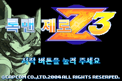

# 록맨 제로 3 · 하르퓨이아 한글 모드

[English](./README.en.md)

하르퓨이아를 직접 조작하여 록맨 제로 3의 전장을 누비는 팬 모드다. 록맨 제로 1·2의 하르퓨이아 전투 동작과 검풍·회오리를 기반으로, 제로 3의 플레이어 전투 시스템에 맞춰 재구성했다.

**[정식 v1.0.0 배포 ZIP 다운로드](https://github.com/holizero/rockman-zero3-harpuia-ko/releases/download/v1.0.0/harpuia-ko-v1.0.0.zip)** · [릴리스 안내](https://github.com/holizero/rockman-zero3-harpuia-ko/releases/tag/v1.0.0) · [ZIP 체크섬](https://github.com/holizero/rockman-zero3-harpuia-ko/releases/download/v1.0.0/harpuia-ko-v1.0.0.zip.sha256)

처음 설치할 때는 위 배포 ZIP을 받아 주세요. GitHub가 자동으로 제공하는 **Source code (zip)**은 실행용 배포 패키지가 아닙니다.



## 모드 구성

- 하르퓨이아 본체·포트레이트·시작 타이틀, 한글 번역·메뉴·전용 아이콘과 공격·피격 음성을 적용했다.
- 쌍검과 검풍, 관성 이동과 발뒤 불꽃 호버링, 수평·수직 비행을 구현했다.
- 새 게임은 기본 장비로 시작한다. 추가 장비와 성장 요소는 게임 진행 중 획득하며, 특정 조건을 갖추면 숨겨진 요소를 사용할 수 있다.
- 오프라인 패치 도구에서 일본판 원본 설치와 원본 복원을 지원한다.

## 설치 방법

1. `harpuia-ko-v1.0.0.zip`을 새 폴더에 모두 압축 해제해 주세요.
2. `하르퓨이아_패치도구.html`을 Edge 또는 Chrome 같은 브라우저로 열어 주세요.
3. 지원하는 일본판 원본 `.gba` 파일을 선택해 주세요.
4. 도구의 저장 버튼으로 결과를 새 파일로 저장해 주세요.
5. 새 롬을 에뮬레이터에서 열고 재시작해 주세요. 처음에는 새 게임으로 확인해 주세요.

별도 설치 프로그램·서버·인터넷 연결은 필요하지 않습니다. 파일은 브라우저 안에서 처리하며 원본을 직접 덮어쓰지 않습니다. 일본판 원본에 한글 번역과 모드를 한 번에 적용하므로, 한국어판을 먼저 준비할 필요가 없습니다.

## 지원 원본

| 항목 | 값 |
|---|---|
| 게임 | Rockman Zero 3 (Japan) |
| 게임 코드 | BZ3J |
| 크기 | 8,388,608바이트 |
| SHA-1 | `ff7a801776dc76e6d8c7ef73a6660ae732934a3f` |

한국어판·북미판·개발 시험판·다른 개조판은 설치 입력으로 지원하지 않습니다. 파일명을 바꾸는 것만으로 지원 원본이 되지는 않습니다.

## 복원과 저장 파일

패치 도구에서 **일본판 원본으로 복원**을 선택하고 이 배포판의 완성 롬을 지정해 주세요. 원래 일본판 바이트로 복원되며 한글 번역도 제거됩니다. 세이브는 변경하지 않습니다.

기존 저장을 사용하기 전에는 에뮬레이터를 종료하고 `.sav` 파일을 백업해 주세요. 이전 버전의 즉시 저장 대신 새 롬을 재시작하고 게임 내 저장을 사용해 주세요. 모든 저장 데이터의 호환성을 검증한 것은 아닙니다.

## 배포 파일과 검증

ZIP에는 오프라인 HTML 패치 도구, 설치·복원 IPS, 한국어 사용 안내·조작표, 실행 화면과 검증 기록을 담았다. **게임 원본·완성 롬·세이브·에뮬레이터는 포함하지 않는다.**

포함된 실행 검증은 mGBA 9개 시나리오·21,450프레임으로 새 게임 시작 상태, 메뉴 전환, 타이틀·복귀·이동·공격·그래픽과 효과음을 검사한 기록이다. 보상 획득은 별도 시험용 결과 화면에서 3개 조건·7,500프레임으로 확인했다. 전체 스테이지 완주·모든 지형과 효과 조합·저장 호환성은 추가 검증 범위다. 자세한 조건은 ZIP의 `검증결과.json`과 `릴리즈정보.txt`를 확인해 주세요.

ZIP SHA-256:

```text
836d474990fa3a2199739470c6936b13f1cff91cc839d09409cbcbc345102204
```

## 다른 록맨 제로 3 모드

- [오메가 제로 한글 모드](https://github.com/holizero/rockman-zero3-omega-ko) — 별도 모드이며 하르퓨이아 패치와 겹쳐 적용하지 않습니다.

## 제작 자료

원작은 CAPCOM / INTI CREATES의 록맨 제로 3이다. 기존 프로젝트의 한국어 번역, 제로 1·2·3 하르퓨이아 자산과 게임 분석 자료를 기반으로 제작했다. 이 저장소는 패치 배포와 안내를 위한 저장소다.
